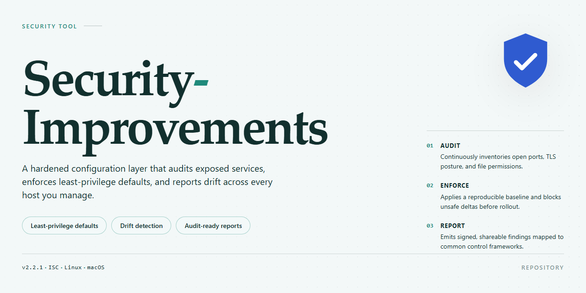

# Security-Improvements: Privacy and System Hardening Scripts — Security Tool

### 🔌 PowerShell Setup Button

   

---

Security-Improvements is a collection of scripts and tools for system hardening, performance tuning, and bloatware removal across supported platforms. Each script applies explicit, auditable changes to telemetry, background services, and access controls, with the goal of reducing attack surface and resource consumption. The toolkit is intended for power users who require deterministic control over system behavior and verifiable configuration changes. All modifications are transparent and documented, and every script should be reviewed before execution against a tested system backup.

## 📋 System Requirements

- **OS:** Windows 10 / 11
- **Shell:** PowerShell 5.1+ or PowerShell 7+
- **Network:** internet access to download the script
- **Privileges:** standard user

## Features

- **Platform-Specific Hardening Scripts** — Dedicated scripts for Windows, Linux, and macOS that apply OS-appropriate security baselines: telemetry reduction, exploit mitigation, service minimization, sysctl/kernel tuning, and outbound firewall enforcement. Each platform directory is self-contained and auditable prior to execution.

- **Bloatware Removal** — Identifies and removes preinstalled applications and background components that consume resources or report diagnostics, with no reliance on third-party removal utilities.

- **Privacy-Focused Defaults** — Disables non-essential diagnostic reporting, background analytics, and telemetry channels across supported platforms. Changes are explicit and reversible where the OS permits.

- **System Optimization** — Trims unnecessary services, startup entries, and scheduled tasks to reduce idle resource usage and shrink the attack surface without affecting core functionality.

- **Transparent, Inspectable Implementation** — All scripts are plain-text and readable. No compiled binaries, obfuscated payloads, or remote code execution at install time. Every modification is visible in the source before it is applied.

- **Reversible Modifications** — Where supported, the tooling documents or provides rollback paths for applied changes so that settings can be restored to their original state.

- **Defense-in-Depth Design** — Independent controls are layered so that bypassing a single mechanism does not compromise the overall configuration. No single script assumes another has run.

- **Minimal External Dependencies** — Scripts rely on native OS facilities and standard shell/PowerShell interpreters, keeping the supply chain small and the execution environment predictable.

## How it works

The toolkit operates through a set of discrete, auditable scripts rather than a single monolithic executable. Each script is scoped to a specific platform and task: hardening, system optimization, or bloatware removal. When invoked, a script first enumerates the current configuration state of the relevant components — registry keys and service states on Windows, sysctl parameters and mandatory access control policies on Linux, launch agents and outbound firewall rules on macOS — and records these values to a plain-text log so that every change remains traceable and reversible.

Changes are then applied sequentially against a declarative baseline. The baseline defines the intended end state — which services are disabled, which telemetry endpoints are blocked, which scheduled tasks are removed, which sysctl values are pinned — and the script reconciles the live system against it. Where a setting is already compliant, no action is taken; where it deviates, the script applies only the delta. This reconciliation model avoids redundant writes and makes repeated execution idempotent, so the tool can be re-run safely after system updates or application installs without compounding side effects.

Bloatware and unwanted components are identified through an explicit allow/deny manifest that names each target by package identifier, service name, or scheduled task path. Nothing is removed by heuristic matching alone; the manifest is plain text and can be inspected or edited before execution. Removal operations move components into a quarantine location rather than deleting them outright, allowing restoration through a companion rollback script that reads the same change log written during the initial run.

Hardening steps follow the same pattern. Network exposure is reduced by closing inbound ports not present on the allowlist, and privacy controls are enforced by disabling non-essential diagnostic reporting, background analytics, and application-level telemetry at the policy layer. Each control maps to a numbered entry in the change log, so a given modification can be traced from its manifest entry to the exact system artifact it altered.

Scripts require elevated privileges, run without network access, and perform no external calls. All logic executes locally against manifests shipped with the repository, which means behavior is deterministic and can be reviewed line by line before any change is made. The change log and quarantine directory together form the recovery path: restoring the pre-run state requires only the log and the rollback script, with no dependency on external infrastructure.

## Privacy

Security-Improvements is designed around a data-minimization principle: the scripts and tools operate locally on the target system and do not transmit telemetry, usage statistics, or system configuration data to the project or any external endpoint. No analytics, crash reporting, or background network callbacks are embedded in the tooling.

- **No outbound data collection.** Nothing in the scripts phones home, uploads logs, or reports execution results. Any network activity is limited to what the underlying commands themselves perform and is documented per platform in the corresponding guide files.
- **Local-only execution.** All hardening, optimization, and bloatware-removal actions run on the machine with the privileges the user grants. Configuration files and logs, where generated, remain on the local filesystem under the paths described in each platform guide.
- **No bundled third-party tracking.** The project does not include analytics SDKs, tracking pixels, or fingerprinting code. Browser extensions referenced in the security stack are separate projects with their own privacy documentation and must be evaluated independently.
- **Transparent, auditable changes.** Every script is plain-text and inspectable before execution. Each modification to registry keys, services, scheduled tasks, or system configuration is defined explicitly in the corresponding script and summarized in the platform guide, so users can verify exactly what is changed.
- **User-controlled scope.** Actions that touch telemetry, diagnostic reporting, or background analytics are opt-in via the scripts the user chooses to run. Nothing is applied silently outside the scope of an executed script.
- **No credential handling.** The toolkit does not collect, store, or transmit credentials, tokens, or personal identifiers. Password management is delegated to dedicated tools in the browser security stack, which are outside this project's trust boundary.

Users who require verification can review the full source of each script prior to execution; the project makes no privacy claims that cannot be confirmed by reading the code.

## FAQ

**Is it safe to run these scripts on a production or daily-use machine?**

The scripts modify core system settings, background services, and security policy. Apply them first in a test environment or after creating a System Restore point or full system backup. Each platform folder contains a `*_guide.README` file listing every setting applied, so changes can be reviewed before execution. The project applies changes in a linear, documented sequence and does not introduce opaque binaries.

**How do I verify what a script will change before running it?**

Every script is plain-text and human-readable. Executable actions are itemized in the corresponding platform `*_guide.README`, which enumerates the apps, settings, and registry keys or configuration files affected. Users can audit the script contents directly and compare against the guide to confirm parity before execution.

**What are the minimum requirements?**

The toolkit targets current, vendor-supported releases of Windows, Linux, and macOS. Linux hardening assumes a systemd-based distribution; some tuning items (kernel sysctl, MAC enforcement, DNS-over-TLS, sandboxing) require a recent kernel with mandatory access control support enabled. Windows scripts require PowerShell with administrative privileges. macOS scripts require root and, where applicable, approval in Privacy & Security settings for firewall and persistence controls.

**Will these changes break application compatibility?**

Some changes are intentionally disruptive by design — telemetry removal, service disabling, and outbound firewall restrictions can affect applications that depend on non-essential diagnostic reporting or unvetted network access. The guides distinguish between conservative settings and aggressive ones. Apply conservative settings first, validate application behavior, and layer additional hardening incrementally.

**How are the settings applied, and are changes reversible?**

Changes are applied through native OS mechanisms: PowerShell cmdlets and registry writes on Windows, sysctl and configuration file edits on Linux, and `launchctl`/`defaults` and firewall configuration on macOS. Each guide documents the applied values so users can revert manually. Create a backup before applying changes; revert steps are per-setting and not automated.

**Does this tool collect telemetry or transmit any data?**

No. All scripts operate locally and make no outbound connections for analytics, reporting, or updates. There is no account system, no background service, and no data collection component. All changes are executed on-device and reflected solely in local system configuration.

**How is bloatware removal performed?**

Bloatware removal targets non-essential preinstalled applications, background services, and scheduled tasks. The scripts identify the executable or service, remove or disable it, and record the action. System-critical components are excluded by name allowlists defined in the scripts. Only items explicitly listed are removed; the guide enumerates exactly what each removal step affects.

**Can the hardening scripts be applied selectively?**

Yes. The scripts are structured so that individual sections can be reviewed and run independently. Users who want telemetry removal without firewall changes, for example, can isolate the relevant section. The platform guides describe each section's scope and dependencies so selective application does not leave the system in a partially configured state.

**Which browsers and platforms are covered?**

System hardening covers Windows, Linux, and macOS. Browser-level protections are platform-agnostic and consist of three recommended extensions: a content filter for malicious scripts and tracking domains, an encrypted password manager for high-entropy credentials, and a redirect-bypass extension to reduce drive-by download exposure. No browser configuration is modified automatically; extension installation is manual.

**How often is the toolkit updated, and against what baseline?**

Updates track vendor-supported OS releases and current hardening guidance. Scripts are revised when an upstream setting changes meaning, when a targeted component is renamed or removed by the vendor, or when a new attack surface is documented. Users should pin to a specific reviewed revision and re-review the guide diff before applying updates.

**What is explicitly out of scope?**

The toolkit does not provide antivirus, endpoint detection and response, network monitoring, or incident response capability. It is not a substitute for patch management, backups, or a security operations program. It does not enforce compliance with any external standard and makes no guarantee of protection against a determined adversary.

## Disclaimer

This repository is provided as-is, without warranty of any kind, express or implied, including but not limited to the warranties of merchantability, fitness for a particular purpose, and non-infringement. The scripts and tools in Security-Improvements modify system-level configuration, including security policies, background services, scheduled tasks, and persistence mechanisms. Such changes can alter system behavior in ways that are not reversible through the tooling itself and may affect third-party software, hardware functionality, or operating system updates.

You are solely responsible for reviewing each script before execution, understanding the modifications it applies, and verifying that those modifications are appropriate for your environment. Creating a full system backup or snapshot prior to running any script is strongly recommended. Testing in a non-production or virtualized environment is advised where feasible.

No guarantee is made regarding completeness of coverage, absence of defects, or suitability for any specific threat model or compliance requirement. Security-Improvements is not a substitute for professional security assessment, endpoint protection, or organizational policy. The maintainers accept no liability for data loss, system instability, service disruption, reduced functionality, or security incidents arising from the use, misuse, or misconfiguration of this project.

Use of this project constitutes acceptance of these terms.

## License

This project is released under the MIT License.

The MIT License grants permission to use, copy, modify, merge, publish, distribute, sublicense, and sell copies of the software, subject to the inclusion of the original copyright notice and this permission notice in all copies or substantial portions of the software.

The software is provided "as is", without warranty of any kind, express or implied, including but not limited to the warranties of merchantability, fitness for a particular purpose, and noninfringement. In no event shall the authors or copyright holders be liable for any claim, damages, or other liability, whether in an action of contract, tort, or otherwise, arising from, out of, or in connection with the software or the use or other dealings in the software.

Redistributions must retain the copyright notice, the list of conditions, and the liability disclaimer. Modified versions must clearly indicate the changes made and may not misrepresent the origin of the original software.